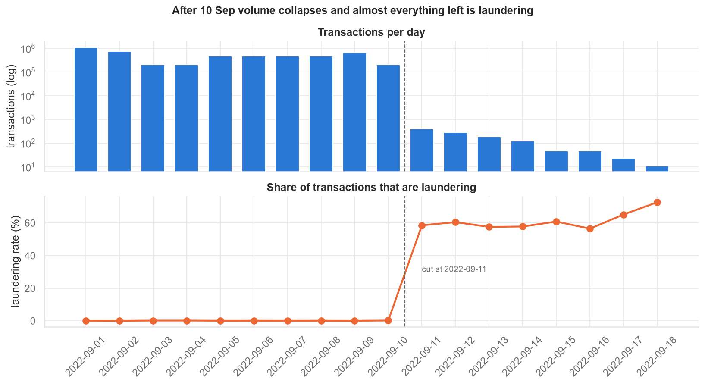
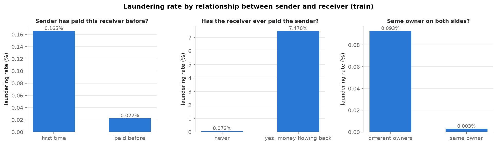
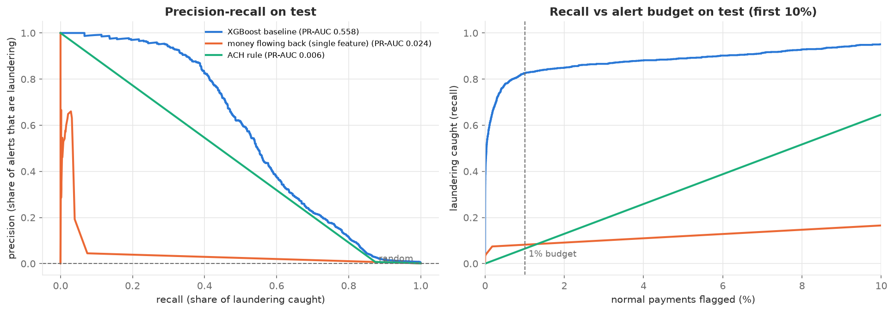
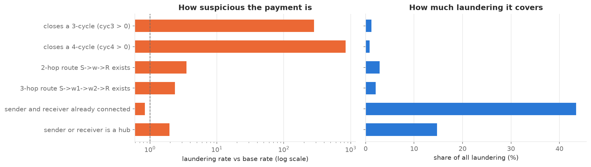
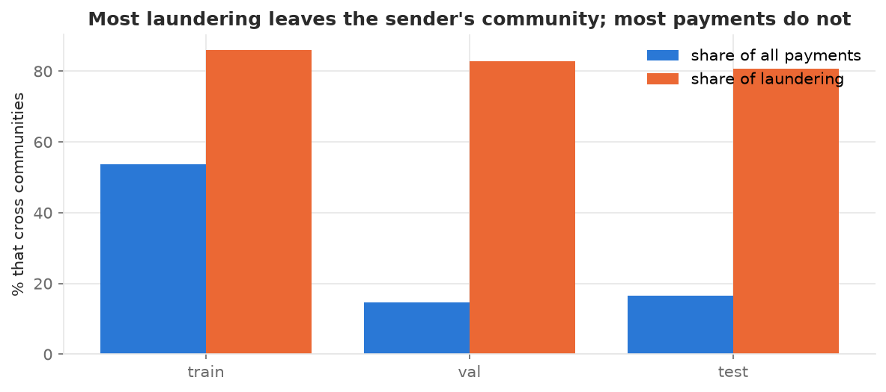
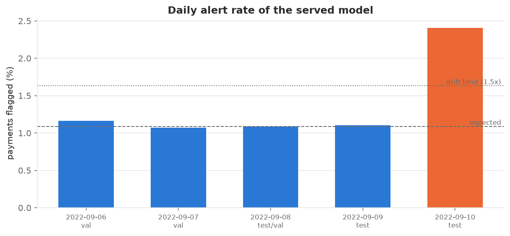

# AML Collusion Detection

Detecting money-laundering transactions and colluding groups of accounts in a 5-million-transaction
payment network, using tabular baselines, graph features and graph neural networks.

> **Status:** complete. All seven steps, from cleaning to a served, monitored model, are done; see the
> [roadmap](#roadmap).

## Results at a glance

All models are trained on 1–6 Sep, tuned on 6–8 Sep and scored once on the test period (8–10 Sep,
1,015,751 payments, 1,143 laundering), using only information from before each payment.

| Model (step) | Test PR-AUC | Laundering caught, 1% of normal payments flagged | Alerts at the threshold fixed on validation |
|---|---|---|---|
| Random | 0.001 | 1% | |
| XGBoost, account features (3) | 0.558 | 82.6% | 20,084 |
| **XGBoost + graph features (4), served in step 7** | **0.567** | 83.2% | **13,979** |
| GraphSAGE (5) | 0.446 | 78.7% | 21,111 |
| Ensemble GraphSAGE + XGBoost (5) | 0.555 | **84.6%** | 16,847 |
| No labels: Isolation Forest + communities (6) | 0.005 | 2.3% | 14,714 |

The ~13% of laundering no model finds is non-ACH payments from a few very large accounts, where
nothing in the data separates laundering from normal traffic (step 4).

## Why this problem

Money laundering is rarely one suspicious payment. It is usually a group of accounts moving money
through fan-outs, cycles and scatter-gather structures. Those patterns are invisible when each
transaction is scored on its own, but they are visible in the graph of who pays whom. This project
measures how much that graph structure adds over a strong tabular baseline.

## Data

[IBM Transactions for Anti Money Laundering](https://www.kaggle.com/datasets/ealtman2019/ibm-transactions-for-anti-money-laundering-aml)
(Altman et al., 2023): synthetic, but generated by a multi-agent simulation of banks, companies and
individuals, with laundering injected as known patterns. This project uses the **HI-Small** variant.

| File | Contents |
|---|---|
| `HI-Small_Trans.csv` | 5,078,345 transactions: time, sender/receiver bank and account, amounts, currencies, payment format, label |
| `HI-Small_accounts.csv` | 518,581 accounts with their bank and owning entity |
| `HI-Small_Patterns.txt` | Laundering transactions grouped into named attempts (fan-out, cycle, ...) |

The data is not in this repository (the transactions file is ~475 MB). Download it from Kaggle and
place the three files in `data/raw/`.

## Step 1 findings

From [`notebooks/01_data_exploration.ipynb`](notebooks/01_data_exploration.ipynb):



- **Sparse tail removed.** After 10 September the simulation stops generating normal traffic while
  existing laundering patterns finish. The remaining 1,108 transactions are ~59% laundering. Left in,
  they would all fall in the test set and inflate every metric, so the data is cut at 2022-09-11.
- **Node identity.** Bank codes carry leading zeros in the transactions file (`010`) but not in the
  accounts file (`10`), and a few account numbers appear at more than one bank. Accounts are
  identified as normalised `bank_account`, giving 515,078 nodes.
- **ACH dominates laundering** (3,828 of 4,522 laundering transactions). Later results will also be
  reported within ACH only, to show models learn more than the payment format.
- **Cross-currency transfers are never laundering** in HI-Small (0 of 71,779), and self-transfers
  almost never are (8 of 590,819).
- **Currency conversion** uses rates derived from the data itself (no FX table ships with it). Rates are
  near-constant (coefficient of variation under ~2%, Bitcoin ~16%).
- **Patterns explain part of the labels.** 1,004 of the 4,522 laundering transactions belong to a named
  pattern, so per-pattern analysis covers that subset only.

**Temporal split** (60/20/20 by transaction count; the model is always tested on later transactions than it was trained on):

| Split | Transactions | Laundering rate | Period |
|---|---|---|---|
| Train | 3,046,186 | 0.075% | 1 Sep – 6 Sep |
| Validation | 1,015,300 | 0.107% | 6 Sep – 8 Sep |
| Test | 1,015,751 | 0.113% | 8 Sep – 10 Sep |

## Step 2: point-in-time features

From [`notebooks/02_feature_engineering.ipynb`](notebooks/02_feature_engineering.ipynb).
75 features per transaction describe the sender, the receiver and their relationship: activity
counts and USD amounts over the last hour, last 24 hours and all earlier history; distinct
counterparties; time since last activity; earlier payments between the two accounts in either
direction; and the owning entity's type and number of accounts.

**No leakage, by construction and by test.** Every feature uses only transactions strictly before the
one being scored (same-minute payments cannot see each other). This is checked three ways: unit tests
against a brute-force implementation, a unit test that deletes future rows, and the same check on the
real data (2,076,752 transactions unchanged after removing everything after 3 September).



Single-feature screening on the train split (no model yet):

- **Money flowing back is the most precise signal.** When the receiver has previously paid the sender,
  7.5% of transactions are laundering, about 100× the base rate, though this covers only a small
  share of laundering. It motivates explicit cycle features in step 4.
- **Laundering goes to new counterparties:** 81% of laundering transactions are a sender's first
  payment to that receiver, against 37% of normal ones.
- **Same-owner transfers are almost never laundering** (0.7% of laundering vs 19% of normal payments).
- **There is signal beyond the ACH shortcut:** within ACH payments alone, the sender's last-hour
  activity still ranks laundering with ROC-AUC ~0.71.
- **No single feature is enough** (best PR-AUC ~0.017 against a 0.00075 base rate), so step 3 combines them.

## Step 3: XGBoost baseline

From [`notebooks/03_baseline_xgboost.ipynb`](notebooks/03_baseline_xgboost.ipynb) (or `python main.py baseline`).
XGBoost on the 75 step 2 features. The training split keeps all laundering and a random 20% of normal
payments; validation and test are never sampled. Four settings were tried; the best on validation
(depth 6, no class weighting, 304 trees) was kept. Alert thresholds are fixed on validation and test
is scored once. These are the numbers steps 4–5 have to beat.

| Test set (8–10 Sep) | XGBoost | Random |
|---|---|---|
| PR-AUC | **0.558** | 0.0011 |
| ROC-AUC | 0.987 | 0.5 |
| Laundering caught at the 1% alert budget | **84.8%** (969 of 1,143) | 1% |
| Share of those alerts that are laundering | 4.8% | 0.1% |



- **It learns more than "ACH is suspicious".** Within ACH payments alone, PR-AUC is 0.637 against
  0.007 for random (88×), and 96.8% of ACH laundering is caught at the 1% budget.
- **But it barely works outside ACH.** For cheque, credit card, cash and Bitcoin payments (144 laundering
  transactions in test), PR-AUC is 0.0016 and only 2 are caught. This is the main gap for graph
  features to close.
- **What it misses looks normal.** 92% of caught laundering is a first payment between the two accounts.
  Only 11% of missed laundering is, and the median missed sender has about 20,000 earlier payments
  (3 for caught ones). These are busy accounts whose single payments look routine, which is where
  the structure of the wider network should help.
- **The threshold drifts over time.** The threshold set to flag 1% of normal payments on validation
  flags 1.9% on test, about 8,600 alerts a day instead of ~5,200. A deployed model would need its
  alert volume monitored (step 7).
- **Most-used features:** self-transfer flag, payment format, the sender's incoming payments in the
  last 24 hours, same-owner flag, and earlier payments between the pair.
- **Per pattern:** only 31 test laundering transactions belong to a named pattern (all
  GATHER-SCATTER, all caught), too few for per-pattern conclusions.

## Step 4: graph features

From [`notebooks/04_graph_features.ipynb`](notebooks/04_graph_features.ipynb) (or `python main.py graph-features`
then `python main.py graph-model`). 20 point-in-time features of the payment network, under the same
rule as step 2 (only earlier transactions, no labels; checked against a brute-force path search and
by deleting future rows):

- **Paths, counted exactly:** routes from the receiver back to the sender in 2 or 3 hops (the payment
  closes a 3- or 4-cycle) and routes from sender to receiver through intermediaries (scatter-gather).
  The 4.5M payments between different accounts form only ~650k distinct edges, so every path can be
  enumerated. The 11 hub accounts (1,000+ counterparties in the train period) are not used as
  intermediaries, since almost any two accounts connect through a hub.
- **Fan-out / fan-in:** new counterparties of the sender and receiver in the last hour and 24 hours.
- **Daily snapshots:** PageRank, connected-component size, and whether sender and receiver were already connected.



The same XGBoost recipe as step 3 (same sample, search and threshold rule), on step 2 + graph
features, compared with the baseline on the same test set. Intervals are 95% block-bootstrap
intervals that resample whole hours of the test set:

| Test set | Baseline | + Graph features | Difference (95% interval) |
|---|---|---|---|
| PR-AUC | 0.558 | **0.567** | +0.009 (+0.001 to +0.016) |
| Recall with 1% of normal payments flagged (equal volume) | 82.6% | 83.2% | +0.6 pts (−0.1 to +1.4) |
| Alerts at the 1% budget fixed on validation | 20,084 | **13,979** | −6,105 (−8,300 to −4,300) |
| Share of those alerts that are laundering | 4.8% | **6.9%** | |
| Recall at that budget | 84.8% | 83.8% | −1.0 pts (−1.8 to −0.3) |

- **A small but real gain in ranking.** PR-AUC improves by about 0.01. Recall at equal alert volume is
  probably better, but its interval still includes 0.
- **The bigger practical effect is a more stable threshold.** The baseline's 1% threshold flagged 1.9%
  of normal test payments; the graph model's flags 1.3%. In deployment that means 30% fewer alerts
  for 1 point less recall.
- **Cycles are the most precise signal in the project but rare.** A payment that closes a 3- or
  4-cycle is laundering ~20% / ~60% of the time, but such payments are about 1% of laundering, and
  the trees barely use them. Graph features hold 7% of the model's gain; the most used is the
  sender's component size.
- **Why the gain is small: the remaining misses are indistinguishable.** Non-ACH laundering (cheque,
  credit card, cash) comes mostly from ten very large accounts sending 12k–170k payments each, of which
  only ~0.15% are laundering. Within their payments no step 2 or graph feature separates laundering
  (best single-feature ROC-AUC 0.53), and neither does the receiver's activity afterwards. No
  transaction-level model can find this laundering in this data, which caps recall at roughly 87%.
  A GNN (step 5) sees the same past graph, so its realistic room is within ACH and in combining signals.

## Step 5: graph neural network

From [`notebooks/05_gnn.ipynb`](notebooks/05_gnn.ipynb) (or `python main.py gnn`, about 30–60 minutes
on a laptop CPU). A transaction on day *k* is scored on a graph of payments before midnight starting
day *k* (a daily snapshot) plus its own step 2 and step 4 features, so nothing from its own future is
visible. Labels are only training targets.

- **GraphSAGE** (PyTorch Geometric): accounts start from a few facts about their history (counts,
  amounts, PageRank, component size); two message-passing layers aggregate their neighbours in both
  directions (from payers and from payees, separate weights). A small network scores each payment
  from the sender and receiver embeddings and the tabular features. Hubs pass no messages, as in step 4.
- **Trained in mini-batches on a laptop CPU:** each step only embeds the accounts within 2 hops of the
  batch (~70k of 515k), which a unit test checks gives exactly the full-graph result; about 1 minute
  per epoch instead of ~16.
- **Ablation:** the same network without message passing, to isolate what the neighbourhood adds.
- **Ensemble:** the average log-odds of GraphSAGE and the step 4 XGBoost, with its own threshold set on validation.

Same training sample, thresholds from validation, test scored once; intervals are block-bootstrap over test hours:

| Test set | Step 4 XGBoost | GraphSAGE | No message passing | Ensemble |
|---|---|---|---|---|
| PR-AUC | **0.567** | 0.446 | 0.434 | 0.555 |
| Recall with 1% of normal payments flagged (equal volume) | 83.2% | 78.7% | 81.3% | **84.6%** |
| Alerts at the 1% budget fixed on validation | **13,979** | 21,111 | 26,657 | 16,847 |
| Recall at that budget | 83.8% | 85.0% | 86.1% | **86.3%** |

- **GraphSAGE alone does not beat XGBoost** (PR-AUC −0.12, interval −0.14 to −0.10). Neural networks
  usually trail gradient-boosted trees on tabular inputs like these, and training is noisy.
- **Message passing adds only a little:** +0.012 PR-AUC over the same network without it (interval
  +0.001 to +0.027), and at equal alert volume the network without it catches slightly more.
- **The GNN catches different laundering, so the ensemble helps where alerts are raised.** At the 1%
  budget GraphSAGE catches 39 laundering payments that step 4 misses (7 of them non-ACH), and step 4
  catches 25 that GraphSAGE misses. The ensemble's PR-AUC is not distinguishable from step 4's
  (difference −0.012, interval −0.027 to +0.003), but it catches **1.4 points more laundering at equal
  alert volume** (interval +0.2 to +2.6) and 86.3% at its validation threshold, for ~2,900 more alerts.
- **Non-ACH laundering stays out of reach** (PR-AUC ~0.002–0.003 for every model), as step 4 predicted.
- **Run-to-run variation:** GNN training on a CPU is not bit-for-bit reproducible (multi-threaded sums
  run in a different order each time), unlike the XGBoost steps. An earlier run gave GraphSAGE 0.458,
  a message-passing gain of +0.056 and an ensemble gain of +2.2 points; the conclusions above hold in
  both runs, the sizes of the gains do not. The numbers here are those in `reports/metrics_step5_gnn.json`.

## Step 6: detection without labels

From [`notebooks/06_unsupervised.ipynb`](notebooks/06_unsupervised.ipynb) (or `python main.py unsupervised`,
about 2 minutes). A bank facing a new scheme has no labels, so no method here sees one; labels are only
used afterwards to measure. Scoring still uses only the past: communities are rebuilt every day from
payments before that day's midnight. Since nothing is fitted on labels, every day can be evaluated,
covering all eight pattern types.

- **Isolation Forest** on each payment's step 2 + step 4 features (fitted on a uniform sample of training payments).
- **Communities** (Leiden, modularity) on the account graph without hubs: does the payment cross
  from one community to another, and how unusual are the communities involved?
- **Combined**: equal-weight average of the three scores' percentiles. Alert thresholds flag 1% of
  all validation payments, so they need no labels either.



| Test set | Combined (no labels) | Isolation Forest (no labels) | Supervised step 4 |
|---|---|---|---|
| ROC-AUC | 0.864 | 0.752 | 0.987 |
| Recall with 1% of normal payments flagged | 2.3% | 0.9% | 83.2% |
| Recall of non-ACH laundering at its threshold | **13%** | 43% (at 4.3% FPR) | 0% |

- **Crossing communities is the strongest label-free signal:** 16% of test payments cross, but they
  hold 81% of the laundering, 21 times the laundering rate of payments within a community.
- **Without labels little is caught at a workable budget** (2.3% vs 83% supervised). In this data,
  laundering is not "unusual" in a generic sense: it has a specific shape that labels teach.
- **But it reaches laundering the supervised models miss:** the non-ACH payments no supervised model
  separates are unusual enough for the Isolation Forest to flag some of them.
- **Schemes:** across all days, 32–67% of attempts per pattern type get at least one alert from the
  combined score at the 1% budget.
- **Collusion groups:** after one alert, the alerted account's community holds on average 50% of the
  scheme's other accounts (49 times what a random set of that size would) and the whole group for
  37% of schemes. Communities are large (median ~1,900 accounts), so they narrow an investigation
  down rather than close it.
- **Label-free thresholds drift:** a cut-off flagging 1% of validation payments flags 4.3% of normal
  test payments for the Isolation Forest, another reason for the monitoring in step 7.

## Step 7: production

From [`notebooks/07_production.ipynb`](notebooks/07_production.ipynb). The step 4 XGBoost is served
through an HTTP API (FastAPI) with a drift monitor, packaged for Docker.

- **Feature store:** the histories steps 2 and 4 use (each account's payments, pairs, graph paths,
  daily snapshots), built from the full history in ~10 seconds with the **same code** as the batch
  pipeline (both were refactored to share it, and still reproduce `features.parquet` and
  `graph_features.parquet` exactly). Sent as raw records, 3,200 real test payments get all 95
  features identical to the batch tables and identical scores.
- **Scoring:** a new payment is cleaned like step 1, gets its features from history strictly before
  its minute, and is scored against the validation threshold. Each result lists the three features
  that raised the score most, for the investigator. Median latency is ~37 ms per payment (~0.3 ms in
  batches). Accounts never seen before score as accounts with no history.
- **Drift monitoring:** the API tracks the alert rate of recent payments against the budget and the
  score PSI against validation; `python main.py monitor` writes the same check day by day.



- **The threshold holds until the last day.** The served model flags ~1.1% of payments per day as
  expected, until 10 Sep, when the simulation winds down (208k payments vs 654k the day before) and
  the alert rate doubles to 2.4%. The step 3 baseline already drifted on 9 Sep, so the graph features
  also made the threshold more stable.
- **The live monitor catches it.** Replaying the test period through the API's monitor, drift is
  sustained from 10 Sep 04:00. Two single-hour flags at midnight (a burst of scheduled payments with
  an unusually low alert rate) are filtered out by requiring three consecutive hours.
- **One feature trends by construction:** connected-component size grows with the graph (PSI > 5
  against training on every day), so it should be monitored against a recent reference or redefined
  relative to the graph before a long deployment.
- **Limits:** scored payments enter the store only when it is rebuilt (e.g. nightly), and a real
  deployment would add authentication, persistence of alerts and retraining on fresh labels.

## Project structure

```
aml-collusion-detection/
├── main.py                     # CLI entry point: python main.py <step>
├── Dockerfile                  # scoring API image (code + model; data mounted)
├── requirements-serve.txt      # dependencies of the API image only
├── src/aml/                    # the package: all reusable logic lives here
│   ├── config.py               # paths and settings (dates, split fractions, alert budgets)
│   ├── schema.py               # raw column names and canonical names
│   ├── io.py                   # load transactions, accounts, Patterns file
│   ├── cleaning.py             # node IDs, currency conversion, flags
│   ├── splitting.py            # chronological train/val/test split
│   ├── quality.py              # data-quality checks and summary tables
│   ├── patterns.py             # link pattern attempts to transactions
│   ├── features.py             # point-in-time account and relationship features
│   ├── metrics.py              # PR-AUC, thresholds at a fixed FPR, feature screening
│   ├── baseline.py             # XGBoost baseline: sampling, search, evaluation
│   ├── graph_features.py       # point-in-time paths, fan and network snapshot features
│   ├── gnn.py                  # GraphSAGE on daily snapshots, mini-batch training
│   ├── unsupervised.py         # Isolation Forest, Leiden communities, group recovery
│   ├── serving.py              # feature store, scorer and drift monitor
│   ├── api.py                  # FastAPI app: /health, /score, /monitoring
│   ├── plotting.py             # shared figure style
│   └── pipeline.py             # each step end to end
├── notebooks/
│   ├── 01_data_exploration.ipynb
│   ├── 02_feature_engineering.ipynb
│   ├── 03_baseline_xgboost.ipynb
│   ├── 04_graph_features.ipynb
│   ├── 05_gnn.ipynb
│   ├── 06_unsupervised.ipynb
│   └── 07_production.ipynb
├── tests/                      # pytest unit tests, incl. leakage tests
├── models/                     # trained models (xgb_baseline.json, xgb_graph.json, gnn.pt)
├── reports/                    # metrics JSON per step; figures/ saved by the notebooks
└── data/                       # raw/ and processed/ (not committed)
```

The notebooks import the same functions the pipeline runs, so exploration and production never drift apart.

## Setup

Requires Python 3.10+.

```bash
python -m venv .venv
# Windows:  .venv\Scripts\activate
# macOS/Linux: source .venv/bin/activate
pip install torch --index-url https://download.pytorch.org/whl/cpu   # CPU build, for step 5
pip install -r requirements.txt
pip install -e .
```

## Usage

```bash
python main.py all                   # every step below, in order (~2 h); stops at the first error
python main.py all --from gnn        # resume from a step (e.g. after fixing a failure)
python main.py all --skip-gnn        # everything except step 5, the longest

python main.py clean                 # step 1: writes data/processed/
python main.py clean --max-date none # keep the sparse tail (not recommended)
python main.py features              # step 2: needs the output of `clean`
python main.py baseline              # step 3: needs the output of `features`
python main.py graph-features        # step 4a: needs the output of `clean`
python main.py graph-model           # step 4b: needs `features`, `graph-features` and `baseline`
python main.py gnn                   # step 5: needs the outputs of steps 3 and 4
python main.py unsupervised          # step 6: needs `features` and `graph-features`
python main.py build-store           # step 7: serving feature store (rebuild when history grows)
python main.py monitor               # step 7: daily drift report -> reports/drift_report.csv
python main.py serve                 # step 7: scoring API on http://127.0.0.1:8000/docs
pytest -q                            # run the tests
```

`python main.py clean` takes about a minute and writes:

| Output | Contents |
|---|---|
| `transactions.parquet` | cleaned transactions with USD amounts, node indices, flags and `split` |
| `nodes.parquet` | `bank_account` → integer node index |
| `pattern_transactions.parquet` | Patterns file rows linked to `tx_id` |
| `cleaning_summary.json` | quality checks, split sizes, pattern coverage |
| `fx_rates.json`, `fx_diagnostics.csv` | derived exchange rates and their stability |
| `daily_profile.csv`, `laundering_by_*.csv` | descriptive tables |

`python main.py features` takes about a minute and writes:

| Output | Contents |
|---|---|
| `features.parquet` | `tx_id`, `split`, label and 75 features per transaction |
| `feature_list.json` | the model input columns |
| `feature_screening_train.csv` | single-feature ROC-AUC and PR-AUC on the train split |

`python main.py baseline` takes about 20 minutes (four XGBoost fits) and writes:

| Output | Contents |
|---|---|
| `models/xgb_baseline.json` | the selected XGBoost model |
| `reports/metrics_step3_baseline.json` | settings tried, thresholds, validation and test metrics, results by alert budget, payment format and pattern, top features |
| `data/processed/baseline_scores.parquet` | baseline score for every validation and test transaction, for comparison with later steps |

`python main.py graph-features` takes about 2 minutes and writes `graph_features.parquet` (`tx_id` and 20
graph features, same rows as `features.parquet`), `graph_feature_list.json` (feature names and hub accounts)
and `graph_feature_screening_train.csv`.

`python main.py graph-model` takes about 20 minutes and writes `models/xgb_graph.json`,
`reports/metrics_step4_graph.json` (as for step 3, plus the bootstrap comparison with the baseline) and
`data/processed/graph_scores.parquet`.

`python main.py gnn` takes 30–60 minutes on a laptop CPU and writes `models/gnn.pt`,
`reports/metrics_step5_gnn.json` (GraphSAGE, the ablation and the ensemble, each compared with steps 3
and 4) and `data/processed/gnn_scores.parquet`.

`python main.py unsupervised` takes about 2 minutes and writes `reports/metrics_step6_unsupervised.json`
(scores vs labels, crossing communities, patterns across all days, group recovery) and
`data/processed/unsupervised_scores.parquet` (every transaction's label-free scores).

`python main.py build-store` takes about 10 seconds and writes `data/processed/feature_store.pkl`
(~600 MB). The API reads it at startup (`AML_FEATURE_STORE` overrides the path):

```bash
curl -X POST http://127.0.0.1:8000/score -H "Content-Type: application/json" -d '{"payments": [{
  "timestamp": "2022-09-08 16:12", "from_bank": "46479", "from_account": "811645E20",
  "to_bank": "20861", "to_account": "811646190", "amount_paid": 13731.57,
  "payment_currency": "Euro", "amount_received": 13731.57, "receiving_currency": "Euro",
  "payment_format": "ACH"}]}'
```

Docker (the image holds code and model; mount the folder with the feature store):

```bash
docker build -t aml-scoring .
docker run -p 8000:8000 -v "$(pwd)/data/processed:/data" aml-scoring
```

## Roadmap

- [x] **1. Cleaning:** validation, node IDs, currency conversion, temporal split
- [x] **2. Account features:** activity and amounts over time windows, counterparties, relationship history, owner info (past data only)
- [x] **3. Baseline:** XGBoost; PR-AUC and recall at a fixed false-positive rate
- [x] **4. Graph features:** paths and cycles, fan-in/out, PageRank, components; gain over the baseline
- [x] **5. GNN:** GraphSAGE in PyTorch Geometric vs the baseline, with an ablation and an ensemble
- [x] **6. Unsupervised:** Isolation Forest and community detection without labels, checked against labels and patterns
- [x] **7. Production:** FastAPI service, Docker, drift monitoring

## Reference

Altman, E., Blanuša, J., von Niederhäusern, L., Egressy, B., Anghel, A., & Atasu, K. (2023).
*Realistic Synthetic Financial Transactions for Anti-Money Laundering Models.* NeurIPS 2023 Datasets and Benchmarks.
